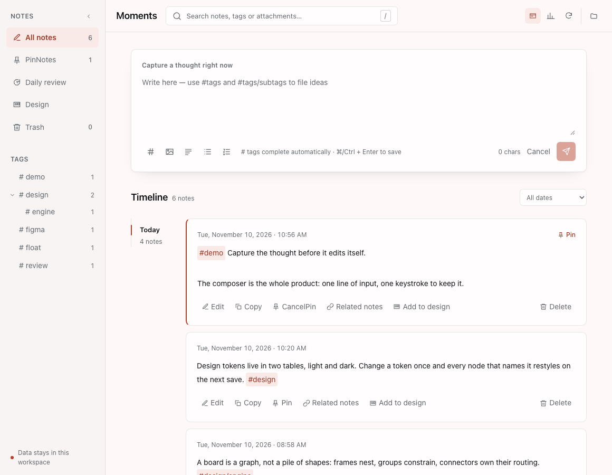
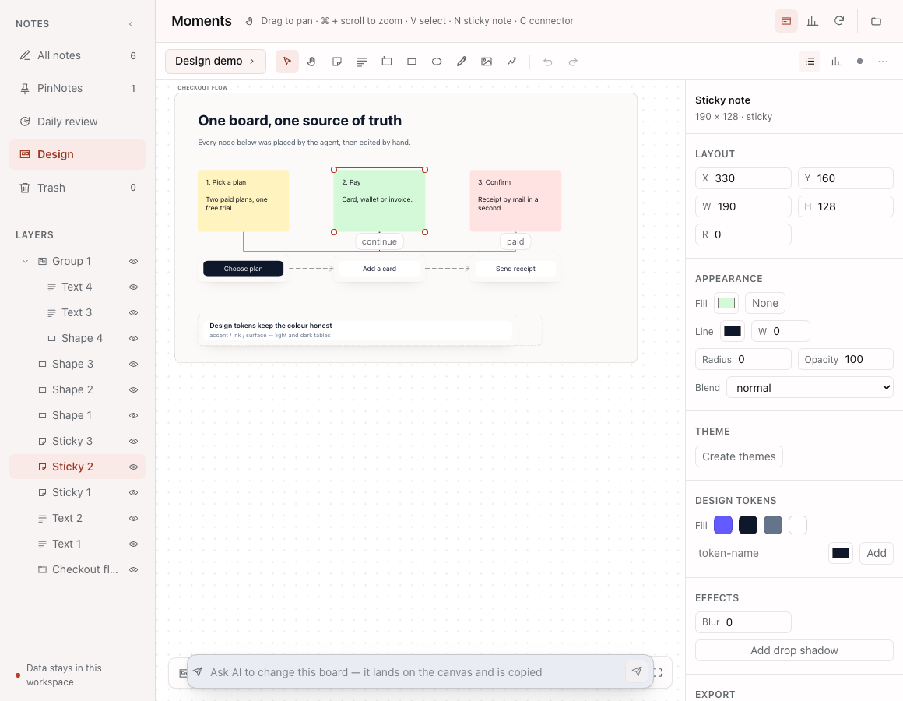
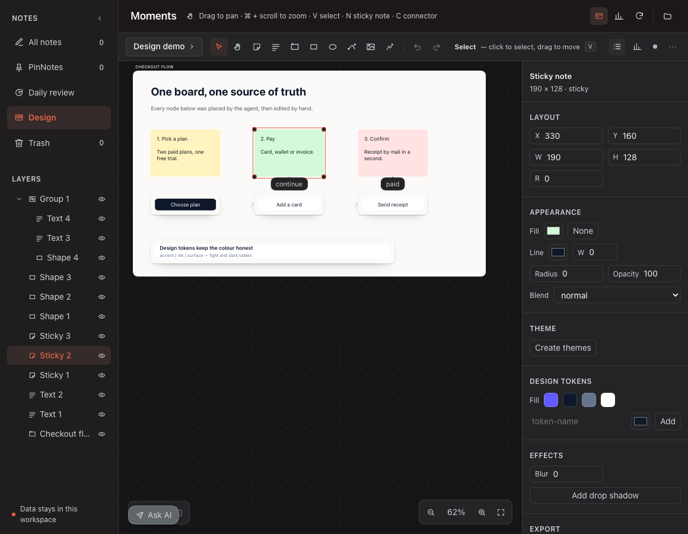
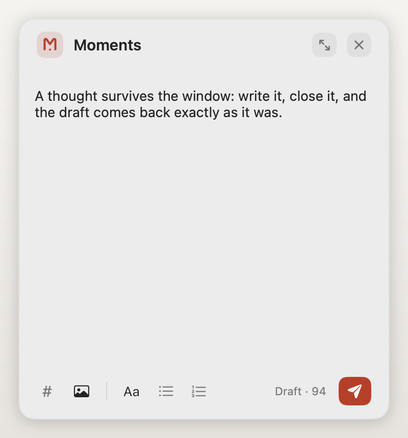

# Moments

A local-first notes workspace for [DeepSeek Harness](https://github.com/deepseek-ai), and a
native **design editor** built into the same panel — six agent tools, a real Figma / FigJam
importer, and a capture float that stays on top of every other app.

> Every screenshot below was taken on a throwaway profile seeded with synthetic demo content.
> No real notes, boards, Figma files or work documents are published in this repository.

## What it looks like









## Two products in one plugin

**Notes.** A timeline you come back to: hierarchy tags, full text search, random review,
"on this day", a writing heatmap, images, JSON backup, Markdown export and a thirty-day trash.
Everything lives in `moments-notes/notes.json` inside the Harness profile. No account, no
server, no network call.

**Design.** A separate mode of the same panel: an infinite board that holds typed nodes —
frames, groups, text, shapes, vector paths, images, components and instances — with
connectors, tokens, auto layout, themes and export to SVG / PNG / HTML / spec JSON. The agent
can author the same board through six tools, so "draw this flow" is a request, not a manual
chore.

## The design editor

- **Infinite board.** Pointer-anchored zoom (0.05×–8×), marquee select, resize handles,
  alignment snapping, undo / redo, layer tree, multi-select, keyboard nudge.
- **Connectors are objects.** Weight 1–8, solid / dashed / dotted, curved / straight / elbow
  routing, four head shapes, a colour and a label. Ends snap to a side and meet it at a right
  angle — an automatic anchor resolves to one edge (wide boxes prefer left/right, tall ones
  top/bottom) and the line leaves and enters along that side's normal, so an elbow only ever
  turns in right angles. Heads are drawn from the line's own geometry, so they stay glued to
  the end of the line and keep the same size at every zoom.
- **Layers are a tree.** Frames and groups nest freely; a container never absorbs its own
  ancestor. A frame is a surface you press anywhere inside; a group is an outline you grab by
  its edge.
- **A real design model.** Design tokens with light and dark tables, auto layout
  (row / column, gap, padding, align), constraints, components and instances, rich text runs,
  gradients, shadows, blur and blend modes, layout grids, vector paths with editable anchors.
- **The tools name themselves.** The bar says what the tool under the pointer does and which
  key picks it, so an icon never has to carry a whole idea on its own.
- **Paths move as shapes, and are edited on purpose.** A selected vector path shows only its
  box handles: press and drag and the path moves as one object. A second tap (or **Edit points**
  in the inspector) opens the anchors, where a drag bends the curve; Esc closes them again.
- **Export that matches the screen.** SVG, PNG, HTML + CSS and a spec JSON of colours, type
  scale, radii and shadows. The chat tool card previews the very same renderer the export
  writes, so a preview can never disagree with the deliverable.
- **Ink follows the fill, not the theme.** A white frame imported from FigJam keeps dark text
  in the dark theme (and a night-blue card keeps light text in the light one); a node with no
  fill of its own reads the frame it sits on, and only then the theme's own ink.

### Figma / FigJam import

Drop a `.fig`, `.jam` or `.deck` on the board (or use **Design → ⋯ → Import Figma file**).
The formats are self-describing Kiwi containers, parsed on the Host with
[`openfig-core`](https://www.npmjs.com/package/openfig-core) — lazily, so a missing parser never
blocks the plugin.

FigJam keeps its real styling in generated overrides rather than on the node, and that is where
this importer reads it: stickies, shape fills and strokes, text colour, connector colour, weight,
dash, caps, line style and arrow heads all survive the trip.

Honest boundaries, because a silently wrong import is worse than a reported one:

- Component **instances are flattened** into groups, and `SYMBOL` definitions are skipped.
- Deep container nesting is **flattened** to keep the layer model sound.
- A "partial file saved" archive may not embed every image. Those frames are kept empty and
  the import report says so; nothing is invented.
- Component variants and prototype interactions are not part of the model yet.

Every import returns a report of what was imported, skipped and merged.

### The agent can design

Six tools write through the same Host store the panel reads, so an agent-built board is an
ordinary board you can keep editing by hand:

| Tool | Role |
| --- | --- |
| `design_begin` | create a board with a screen frame |
| `design_tokens` | define colour tokens and type styles, light and dark |
| `design_nodes` | one transaction of inserts, updates and deletes |
| `design_finish` | validate and report the board digest |
| `design_inspect` | read back the boards, or one board's nodes |
| `design_export` | export SVG, HTML or the spec JSON |

The whole batch commits or is rejected together, and tokens, auto layout and instance
expansion are recomputed on the Host at save time, so the file never drifts from the rules.

## Notes that survive

- New, edit, copy, pin, expand, soft delete, restore, purge; trash kept for 30 days.
- PNG / JPEG / WebP / GIF attachments, up to 8 per note and 10 MB total; a picture-only note is
  still a note.
- Hierarchical `#tags` with autocompletion and counts, full text search, recent searches,
  combined filters.
- Memo / Tag / Day statistics, activity heatmap, random review, "on this day" in past years,
  related notes.
- JSON merge or replace import, complete JSON backup, Markdown export.
- `moments_memo` lets the assistant create and search notes through the same store.

## The capture float

A real always-on-top window — a separate macOS process, not a web overlay. Window level
`.floating`, joins every Space, stays above full-screen apps, keeps its place when you switch
applications. Type a thought, paste a screenshot, press `⌘/Ctrl + Enter`; one click expands it
into the full history panel without moving the window.

Closing the window never costs a thought: the editor writes a draft three seconds after the
last change and flushes it on close, `SIGINT`, `SIGTERM` or stdin EOF, so the text, the
attachments and the "editing which note" state come back when the window reopens.

The float and the Host talk over JSONL on stdin/stdout, so closing the window, ending input, or
`SIGINT` / `SIGTERM` leaves no orphan process behind. If the helper was never built, the plugin
says so and falls back to an in-page float.

The capture card carries no scrollbar: a permanent scroller column reads as a stray strip on an
otherwise empty card, so the scroller is removed while the text still scrolls with the wheel and
the caret keeps itself in view.

## Diagnostics

Nothing fails silently. Every failure the Host answers — validation errors, unexpected
exceptions, failed saves, and the six design tools — is appended to
`moments-notes/diagnostics.log` as one JSON line (rotated once at 1 MB), and the error banner
shows the log id (`E-…`) with a **View log** dialog: time, source, method, code, message, and,
for a rejected save, the board id, the node count and the nodes that broke a limit. Browser
`error` and `unhandledrejection` events are recorded in the same log.

## Install

The plugin is a Harness bundle. Clone this repository and install it into a profile:

```sh
git clone https://github.com/colsonSung/dsh-moments-notes.git
cd dsh-moments-notes
./install.sh web          # or: ./install.sh desktop
```

`install.sh` installs the package with `dsh plugin add` and adds the bundle row to the
profile's patch layer; both steps are idempotent. Restart the Harness afterwards and open
**Moments** from the sidebar.

Without the script, point the `plugin_manager` at the checkout:

```
plugin_manager install_bundle /path/to/dsh-moments-notes/plugin
```

The bundle declares its only runtime dependency (`openfig-core`, MIT) and installs it with the
package.

### Build the desktop float

The always-on-top window is a small Swift application the Host starts as a child process. Build
it once per machine:

```sh
cd dsh-moments-notes/plugin
./native/build.sh          # writes native/bin/moments-float
```

Requirements: macOS 13 or later and a Swift compiler. The build script finds the compiler and
the macOS SDK on its own, so it also works before the Xcode license has been accepted (where
`xcrun` refuses to run). The binary is ignored by git: it is built per machine.

## How it is built

```
plugin/
  index.js               the Host plugin: the authenticated API route, the agent tools, the
                         trash retention job, the diagnostics log and the desktop float process
  client.js              the panel, the float and the design editor, as one React module bundle
  lib/                   the note store, domain rules, Host service, HTTP route, float bridge,
                         and for design: the canvas store, canvas rules, image assets, the
                         Figma reader, the exporter, the agent tools and the log
  native/                the always-on-top window: an AppKit / SwiftUI accessory app whose
                         NSWindow sits at .floating level, joins every Space and stays above
                         full-screen apps
  tests/                 node:test suites; no network, no fixtures from a real file
docs/screenshots/        the demo images used above
```

## Development

```sh
cd plugin
npm ci
node --test tests/*.test.js     # 400 pass, 1 skipped
node --check client.js
./native/build.sh && ./native/bin/moments-float --self-test
```

The one skipped test builds and runs the native helper; it skips itself when
`native/bin/moments-float` has not been built yet, which is the state of a fresh clone.

## License

MIT — see [LICENSE](LICENSE). Third-party notices are in
[THIRD_PARTY_NOTICES.md](THIRD_PARTY_NOTICES.md).
